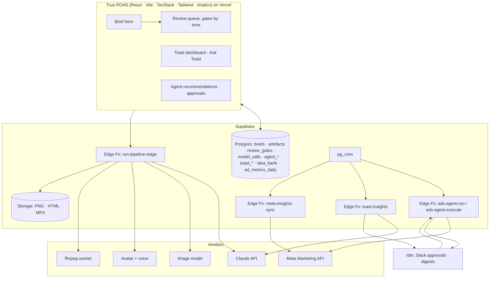

# Architecture · how this fits CerealBox's stack

## Runtime shape in production



- **The pipeline code in `src/` is plain TypeScript with no framework dependency**, so it runs unchanged in a Supabase Edge Function (Deno) or a Node worker. The CLI in `src/cli/` is just one host.
- **Secrets stay server-side.** Meta tokens and the Anthropic key live in Edge Function secrets. n8n calls Edge Functions with a service-role header; the browser never sees a vendor key.
- **Postgres is the queue.** A review gate row with `decision = 'pending'` is the work item; approving it (UI or Slack via n8n) triggers the next stage. No extra queue infrastructure until volume demands it.
- **Storage** holds renders; `artefacts.storage_path` points at them.

## Data model

See `supabase/migrations/0001_ai_studio_schema.sql`. Key tables:

| Table | Purpose |
|---|---|
| `campaign_briefs` | The single source of truth per campaign (JSON validated by `CampaignBriefSchema`) |
| `artefacts` | Every generated thing, by kind and version, with guardrail score and issues |
| `review_gates` | Every human decision: gate, risk, who, why, when |
| `model_calls` | Tokens, cost, latency, stop reason, schema validity per task |
| `agent_runs`, `agent_recommendations`, `agent_actions` | The ads agent's memory and audit trail; recommendation ids are idempotent per day |
| `toast_digests`, `toast_questions` | Daily digests; questions with thumbs up/down for evals |
| `idea_bank` | Every idea ever, with later performance, feeding novelty scoring |

Row-Level Security: agency staff (JWT `app_metadata.role` in staff/admin) see everything; client users see rows where `client_id` is in their `app_metadata.client_ids`.

## Scheduled jobs (pg_cron → Edge Functions)

| When | Job |
|---|---|
| 06:30 daily | Meta insights sync into `ad_metrics_daily` (True ROAS already has this) |
| 07:00 weekdays | Ads agent run at the configured autonomy level |
| 07:15 weekdays | Toast insights + narrative, stored as the digest |
| Sunday 02:00 | Idea bank performance refresh from ad metrics |

## n8n

Two exports in `automations/n8n/`:
- `toast-daily-digest.json`: schedule → Edge Function → Claude narrative → Supabase → Slack; critical insights page `#ads-alerts`.
- `ads-agent-approval.json`: webhook from the agent run → split → route by risk tier → escalate human items, one-click Slack approval for approve items → execute via Edge Function or mark rejected.

n8n is for human-facing glue. Anything that touches money or a vendor token is an Edge Function.

## The web app (`web/`)

The True ROAS "AI Studio" module, in the stack CerealBox already runs: Vite, React 19, TypeScript, Tailwind v4, TanStack Query, Recharts, shadcn-style primitives. It imports the same pure TypeScript as the pipeline (`@src/areas/toast/metrics`, `@src/areas/toast/ask`) so the browser computes KPIs and answers questions with the exact functions the CLI and Edge Functions use. Three views:

| View | Reads | Does |
|---|---|---|
| Toast | `toast/dataset.json`, `toast/insights.json` | KPIs with deltas, spend vs revenue, ROAS vs target, creative types, insights, Ask Toast |
| Review queue | `<brief>/review-queue.json` + artefact files | Lists every gate with guardrail score; previews ideas, copy, creative PNGs, scripts, UGC manifest, landing iframes, launch plan; approve / reject with a note (localStorage in the demo, `review_gates` in production) |
| Ads agent | `agent/run.json` | Autonomy ladder, alerts, recommendations by risk tier with approve / reject, morning briefs |
| Client reports | `reports/index.json`, `comms/replies.json` | Weekly report per client in an iframe with its verified-figures badge; drafted replies with risk tiers and approve-to-send |

In production the JSON loaders become Supabase queries behind Row-Level Security and the approve button calls `run-pipeline-stage` / `ads-agent-execute`.

## Edge Functions (`supabase/functions/`)

`toast-insights`, `ads-agent-run`, `ads-agent-execute` and `run-pipeline-stage` are Deno handlers that import the pipeline modules directly (sloppy imports enabled in `deno.json`), authenticate with the service-role key and keep every vendor secret server-side. See `supabase/functions/README.md`.

## Learning loop and launch

- **Idea bank** (`src/areas/ideas/bank.ts`): every idea generated for a client is stored (JSON locally, `idea_bank` table in production). The next brief for that client passes them in as previous ideas, so repeats score lower, and the angles selected last time are excluded from generation. A weekly job attaches ad performance so "what worked" is queryable.
- **Meta launch payloads** (`src/areas/media-buyer/launch.ts`): the launch plan becomes Marketing API objects, all `PAUSED`, budgets in minor units, pixel-based conversion optimisation, placements mapped to positions, UTMs carrying ad name and landing variant. Creation runs from `ads-agent-execute`-style Edge Functions after a human approves the preview.

## Code layout in this repo

```
src/core        brief schema · LLM provider (mock/anthropic) · guardrails · review gates · audit · cost · ads data model
src/areas       one folder per area: types (zod) · generate (defineTask) · validate/checks · render
src/orchestrator the end-to-end pipeline with gates
src/evals       red team · scorecard · agent recall
src/cli         demo · toast · agent · eval · video · reports
web             Vite + React app (Toast · review queue · ads agent · client reports) with jsdom tests
tests           vitest: 384 tests across core, every area, reporting, comms, idea bank, launch payloads, orchestrator, evals, judge, images, video render, automations, CLI, web; tests/edge-cases holds 120 production scenarios (41 bugs found and fixed); 3 live tests gated on a key
.github         CI: verify on every push; live smoke test when ANTHROPIC_API_KEY is set
automations/n8n two importable workflows
supabase        migration with schema, RLS, pg_cron; four Edge Functions
samples         two charity briefs and transcribed footage metadata
```

## Switching the model

```
LLM_PROVIDER=anthropic ANTHROPIC_MODEL=claude-opus-5-5 npm run demo
```

The Anthropic provider uses structured outputs (`betaZodOutputFormat`), adaptive thinking with a per-task effort level, optional model routing per effort tier (`ANTHROPIC_MODEL_LOW` / `_MEDIUM` / `_HIGH`, see `docs/AUDIT.md` COST-02), per-task output ceilings, and the server-side refusal fallback. `cache_control` is set on the system prompt but does not engage today: the prompts are below the 512-token cache minimum (`docs/AUDIT.md` COST-01); the real caching win is moving the brief into a shared cached block, which is on the roadmap. Every output is re-validated against the task's Zod schema; refusals and truncation raise typed errors that the pipeline records and surfaces at the gate.
