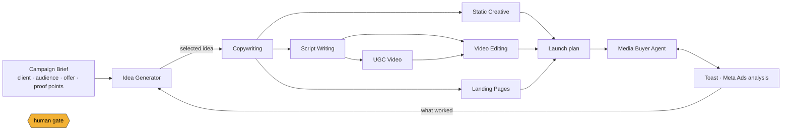

# CerealBox AI Automation & Creative Workflow Challenge

**Candidate:** Haseeb Metla · **Submission date:** 10 November 2026
**Repository:** `cerealbox-ai-studio` (this folder) · **Run it:** `npm install && npm run verify`

---

## 1. The one-paragraph answer

CerealBox does not need nine AI tools. It needs **one campaign brief that flows through nine stages**, with the same guardrails, the same review screen and the same audit trail at every step, sitting inside the platform the team already uses (True ROAS). Ideas feed copy, copy feeds statics and scripts, scripts feed UGC and editing, everything feeds landing pages and a launch plan, and the ad data that comes back (Toast) feeds the Media Buyer agent and the next round of ideas. AI generates and proposes; deterministic code checks; humans approve anything that touches a client's brand, money or a real person. I have built a working prototype of that whole loop, offline and reproducible, with 384 automated tests, and this document explains the reasoning behind each piece.

Every arrow passes through three things: a **typed schema** (the model must return exactly this shape), **guardrails** (deterministic checks for claims, limits, brand words, placeholders, PII, invented statistics), and a **review gate** (auto / one-click approve / human decision). That is the whole architecture; the rest is detail.

---

## 2. How to read this submission

| What you want | Where |
|---|---|
| The approach for every area, end to end | Section 4 below, then one file per area in `docs/areas/` |
| The working demo | `npm run demo:all` writes everything to `out/` for two briefs; `npm run web` opens the React app; `npm run video` renders a real MP4; `docs/DEMO_SCRIPT.md` is the 20-minute walkthrough |
| Where AI is used vs. where humans decide | Section 5 and the "AI vs human" table in each area doc |
| Quality controls, maintenance, scale and cost | Sections 6, 7, 8 |
| Milestones: 2 weeks / 30 / 60 / 90 days | `docs/ROADMAP.md` |
| How it fits the stack (Supabase, React, Vercel, n8n) | `docs/ARCHITECTURE.md`, `supabase/migrations/`, `automations/n8n/` |
| Proof it works | `npm test` (384 tests, node + browser), `npm run eval` (red team, scorecard, agent recall, LLM-as-judge), CI on every push |
| How it was hardened | `docs/PRODUCTION_RISKS.md`: 120 production scenarios tested, 41 bugs found, every one fixed with its test kept as a regression guard |
| Security, performance, cost and tech-debt audit | `docs/AUDIT.md`: every finding with its proof; improvements landed behind golden-output tests that pin every generated artefact byte-for-byte |
| Interview slides | `docs/deck.html` (open in a browser, arrow keys to move) |

---

## 3. Principles I designed against

1. **Brief in, everything out.** One structured brief (`src/core/brief.ts`) is the source of truth. If the offer changes from £30 to £25, every downstream asset regenerates from the same object instead of being edited in nine places.
2. **AI proposes, code checks, humans decide.** The model never decides to pause an ad or publish a page. Deterministic rules and checks run on every output; a human approves anything that is brand, money or people.
3. **Schemas, not prose.** Every model call has a Zod schema and uses Claude's structured outputs, so a "creative idea" or a "recommendation" is data the rest of the system can act on, not a paragraph someone has to copy-paste.
4. **Deterministic mock first, real model second.** Every AI task ships with a deterministic mock, so the pipeline runs offline, tests are reproducible, and the demo costs nothing. Switching to Claude is one environment variable; the code path is identical.
5. **Measure everything.** Every model call logs tokens and cost; every guardrail result and review decision is recorded. This is how we know what to improve and what it costs per campaign.
6. **Autonomy is earned.** The ads agent starts in "assist" mode for every client and moves up the ladder (copilot, autopilot) only once its recommendations have been accepted consistently.

---

## 4. Workflow for every area

Each area has its own document with the full flow, tools, risks and prototype details. This section is the summary; the links are the depth.

### 4.1 AI Idea Generator · `docs/areas/01-idea-generator.md`
*"Can AI consistently generate genuinely interesting ideas?"* Yes, if you stop asking it for "ideas" and start asking for **angles**. The generator forces each idea to take a named angle (contrast, stat-led, myth-bust, letter, unexpected comparison, 12 in total), grounds it in the brief's real objections and proof points, then **re-scores it in code**: novelty against every idea the client has run before, brand fit against banned words, duplicates demoted. An idea bank stores everything with later ad performance attached, so "what worked" feeds the next brief. Humans pick from a ranked shortlist; the model never picks for them.

### 4.2 AI Copywriting · `docs/areas/02-copywriting.md`
Idea plus brief go in; a **copy pack** comes out: hooks, headlines, three primary-text lengths, descriptions, story overlays, CTA button and messaging pillars. Every field is validated against Meta's character limits (recommended and hard), checked for guarantees, cure claims, pressure language, US tax framing, banned brand words, placeholders, PII and statistics not in the brief. Blocked variants are removed automatically; warnings go to the reviewer with the excerpt highlighted. Copy is approved as a pack and versioned.

### 4.3 AI Static Creative · `docs/areas/03-static-creative.md`
The model writes a **creative spec** (layout, headline, subline, stat, badge, CTA, image prompt, palette roles), not pixels. A template renderer turns the spec into on-brand SVG/PNG in all three Meta formats, and automated checks run before a designer looks: WCAG contrast, text coverage, Stories safe zones, overflow, logo and CTA present, consent flags on image prompts. Image generation (Ideogram/Imagen/Firefly for backgrounds) plugs in behind the image prompt; the layout stays deterministic so brand compliance is guaranteed, not hoped for.

### 4.4 AI Script Writing · `docs/areas/04-script-writing.md`
Scripts are **beats** (hook, problem, turn, proof, offer, CTA) with voiceover, on-screen text, visual direction, b-roll keywords and seconds per beat, in five styles and three lengths. Validation checks pacing (hook lands in 3 seconds), total voiceover versus duration at 150 words per minute, structure, the same text guardrails as copy, and flags scripts that will need an AI-disclosure label.

### 4.5 AI UGC Video · `docs/areas/05-ugc-video.md`
An approved script becomes a **production manifest**: persona, shot list, voice and avatar provider settings, deliverables, disclosure, and four approval gates (script, persona, rough cut, final). The honest answer to "can AI do all of UGC" is: informational and explainer content, yes, with HeyGen/Synthesia-class avatars and ElevenLabs voice; **testimonials, no**: a synthetic person telling a story as if it happened to them is misleading, so the system refuses to cast a synthetic presenter for testimonial scripts and routes them to real creators. The renderer interface is provider-agnostic so we can swap tools as they improve.

### 4.6 AI Video Editing · `docs/areas/06-video-editing.md`
Raw footage is transcribed (Whisper), then the model matches script beats to clip segments; code assembles an **edit decision list**, generates broadcast-rule captions (SRT), checks pacing (first cut, average shot length), and emits an ffmpeg render plan with brand end card, music ducking and per-placement exports. A human reviews the rough cut; the final export is one approval away. For higher-end finishing we hand the EDL to a Premiere/Resolve template rather than fighting the last 10 percent in code.

### 4.7 AI Media Buyer / Ads Agent · `docs/areas/07-media-buyer-agent.md`
The launch plan also exports as Meta Marketing API payloads (campaign, ad sets, creatives, ads) with everything paused, budgets in pence and UTMs per landing variant, so "launch" is a reviewed diff rather than manual Ads Manager work. Seven deterministic rules (tracking break, CPA spike, ROAS floor, winner to scale, creative fatigue, dead ad, learning limited) run daily over the metrics table and produce **recommendations with a risk tier and a proposed change**. Claude writes the morning brief from those findings but never invents one. Alerts go to Slack, approve-tier items get a one-click button (n8n flow included), human-tier items wait for a decision, and the **autonomy ladder** (assist, copilot, autopilot) controls what executes by itself, inside hard budget caps. Everything the agent does is in an audit table.

### 4.8 AI Landing Pages · `docs/areas/08-landing-pages.md`
The model writes a **page spec** (hero, problem, impact tiers, proof, story, FAQ answering the audience's real objections, trust, form, closing CTA) and a deterministic renderer builds the page. Checks catch what quietly kills conversion or breaks the rules: two H1s, no CTA above the fold, images without alt text, form amounts that do not match the ad, missing Gift Aid declaration, missing charity number, missing UTM passthrough, placeholder copy. A/B variants differ in exactly one stated hypothesis. In production the spec renders through a React template on Vercel with the real donation form.

### 4.8b Beyond the nine areas: client reporting and client communications
The job description asks whether reporting can be almost fully automated and whether AI can safely answer repetitive client queries. Both are built with the same pattern. **Client reports** (`src/areas/reporting/`): code computes the figures and translates internal recommendations into client-safe language ("we are trimming budget where the cost per donation has risen", never "CPA spike"); the model writes the narrative; a verifier proves every number in the narrative exists in the input before the page renders, and the footer says so. **Client communications** (`src/areas/comms/`): the model drafts replies from real figures; billing, complaints and anything off-topic are escalated with a reason and a holding note; every draft passes the text guardrails and a strict number check; only clean, confident, data-backed drafts are marked ready to send, and a human always sends.

### 4.9 Toast / Meta Ads Analysis · `docs/areas/09-toast.md`
Toast already exists inside True ROAS as the data layer. What I add: a **deterministic aggregation layer** (client, campaign, ad set, ad, creative type; period comparison; daily series; z-score anomalies; spend pacing), **rule-based insights** with exact figures, a **narrative** written by Claude from those insights only, a dashboard, and **"Ask Toast"**: natural-language questions translated by the model into a typed query that code answers, so the numbers are always real and the same question always gives the same answer on the same data.

---

## 5. Where AI is used and where humans still decide

| Stage | AI does | Code checks | Human decides |
|---|---|---|---|
| Ideas | Generates 10 angled ideas, self-scores | Novelty vs. history, duplicates, brand fit | Picks the shortlist; nothing proceeds without this |
| Copy | Writes the pack | Limits, claims, PII, facts, voice | Approves the pack; edits warnings |
| Statics | Writes specs and image prompts | Contrast, coverage, safe zones, overflow, consent | Approves creatives; chooses photo |
| Scripts | Writes beats | Pacing, duration, structure, text guardrails | Approves; decides style mix |
| UGC | Casts persona, drafts shot list | Testimonial = never synthetic; disclosure; gate order | Approves persona, rough cut, final |
| Video | Picks clip segments, writes captions | Pacing, clip bounds, caption rules | Reviews rough cut; approves export |
| Landing | Writes page spec | Structure, compliance, Gift Aid, amounts, UTM | Approves; picks A/B hypothesis |
| Ads agent | Writes the brief, explains and prioritises | All rules, risk tiers, caps, idempotency | Approves budget moves; decides pauses, tracking fixes |
| Toast | Narrates insights, parses questions | All aggregation and anomaly maths | Interprets; acts |

The rule of thumb: **AI touches text and suggestions; code touches numbers and structure; humans touch brand, money and people.**

---

## 6. Quality controls

How I reduce bad outputs, hallucinations and poor creative:

- **Structured outputs.** Every model call returns JSON matching a Zod schema (`output_config.format`). Malformed output fails loudly and is retried; it never reaches a reviewer.
- **Allowed facts.** The only numbers the system accepts are the brief's proof points, tiers, match-funding line and statutory facts (Gift Aid 25 percent). Any other statistic is flagged as unverified; in strict mode it blocks.
- **Deterministic guardrails before human review** (`src/core/guardrails.ts`): guarantees, cure claims, 100 percent / every penny, US tax framing, pressure and guilt language (Fundraising Regulator code), superlatives, placeholders, email/phone leaks, banned brand words, character limits, missing CTA, reading grade. Severity is block / warn / info, and a red-team suite (`npm run eval`) proves each rule still fires.
- **Visual and structural checks** on creatives and landing pages, so reviewers spend time on judgement rather than spotting a missing Gift Aid line.
- **Angle enforcement and novelty scoring** against the idea bank, which is the actual fix for "generic ideas". The bank persists across runs: the second campaign for a client excludes last time's angles and marks down repeated ideas automatically.
- **Review gates with an audit trail.** Nothing ships from a gate marked pending or rejected; every decision is stored with who and why.
- **Evals in CI.** Red team (known-bad must be caught, known-good must pass, for every sample brief), pipeline scorecard (what share survives QA), agent scenario recall (every injected account problem must be detected, nothing else flagged), judge (no rejects). The GitHub Actions workflow runs all of it on every push; a prompt or model change that regresses any of these does not merge. With an API key in CI secrets, a live smoke test also runs against Claude.
- **Number verification on anything a client reads.** Weekly reports and drafted replies are scanned for every numeral; each must exist in the computed input, or the item is flagged for review rather than sent.
- **LLM-as-judge for creative quality.** Every package's primary idea, short copy, first script and landing hero are scored 1-10 on clarity, specificity, emotional pull and brand fit with a ship / revise / reject verdict (`src/evals/judge.ts`). The eval run fails on any reject. Offline the judge is a heuristic baseline; with the Anthropic provider it is Claude on the same rubric, and the baseline is what we calibrate it against with human spot checks.

---

### Knowing where the edges are

Before calling anything production-ready I ran a deliberate breakage pass: 120 scenarios across hostile brief input, guardrail false negatives and false positives, renderer limits, bad footage and model mistakes, re-synced ad data, misbehaving reviewers, client emails and CLI misuse. 76 passed first time; 41 bugs were found, catalogued by severity in `docs/PRODUCTION_RISKS.md`, and then fixed in product code without touching the tests, so the 120 scenarios now stand as regression guards. The S1 items (money and trust) were fixed first: duplicate-row double counting, an ads client with no timeout, an unvalidated autonomy flag, two guardrail gaps on invented statistics, a third-party form action, `javascript:` URLs, a rubber-stamp approval path and a zero-data client reply.

A second pass audited the result for security, performance, cost and tech debt (`docs/AUDIT.md`). It found no critical defects and one production-breaking configuration gap (the scheduled jobs sent no auth header, so every Edge Function would have rejected them), plus hardening items (constant-time secret checks, a validated Meta write path, image-vendor response validation, sandboxed previews, atomic idea-bank writes, least-privilege CI), a render pipeline that was twice as slow as it needed to be, prompt caching that could never engage, and seventeen duplicated helpers. Every improvement landed behind a golden-output suite that pins every generated artefact byte-for-byte, so the proof that nothing changed is a passing test, not a claim.

## 7. Maintenance

- **Tasks, not prompts scattered in code.** Each AI step is a `defineTask` with name, schema, system prompt, prompt builder, mock and effort level. Changing a prompt is a pull request with evals attached.
- **Provider abstraction.** `LLM_PROVIDER=mock|anthropic`, model by environment variable. When a better model ships, we change one variable, run the evals, compare scorecards, and roll forward or back.
- **Telemetry.** The `model_calls` table records tokens, cost, latency, stop reason and schema validity per task; the `review_gates` table records approval rates per gate. A rising rejection rate on one gate is the signal to fix that prompt.
- **Scheduled, observable jobs.** pg_cron triggers Edge Functions; n8n handles the human-facing glue (Slack approvals, digests). Failures alert; nothing silently stops.
- **Thresholds are data.** The agent's rules read a per-client config (target ROAS, CPA, frequency cap, budget step, caps). Media buyers tune numbers; nobody edits code.
- **Quarterly tool review.** The UGC cost table and renderer adapters exist precisely so we can swap HeyGen for whatever is better next quarter without touching the pipeline.

---

## 8. Scale and cost

**Model cost is small; people cost is the lever.** Measured with the mock provider's token accounting at Opus 5.5 list prices, one complete campaign package (10 ideas, copy pack, 3 creatives, 3 scripts, UGC manifest, edit plan, 2 landing pages) costs about **$0.15**, and a daily agent run across 6 clients about **$0.02**. At 30 clients with two campaigns a month plus daily agent runs, model spend is in the tens of dollars a month even before prompt caching or routing cheap tasks (intent parsing, briefs) to Haiku. Image, avatar and voice generation dominate: roughly £25 to £40 per synthetic UGC video versus £350 for a real creator, and a few pence per generated background image.

**Multi-client by construction.** Everything is keyed by client, protected by Row-Level Security, and the brief carries the client's voice, palette and compliance notes, so one pipeline serves 30 charities with 30 different voices.

**Limitations to be honest about:**
- Offline, content comes from the brief's `creativeContext` seeds through deterministic templates; it reads well for both sample briefs (fuel poverty and food bank) but it is a stand-in for Claude, not a substitute.
- Image generation is a deterministic abstract scene offline; a real image API plugs in through one environment variable, but no live vendor was called here. Avatar and voice vendors and the Meta API are adapters with mocks; the Edge Functions show the live wiring and were not run against Supabase.
- Video renders for real with the bundled ffmpeg, but on synthetic stand-in footage generated from the clip manifest.
- Meta's Marketing API rate limits and review delays mean "autopilot" is a throttled, batched job, not real-time.
- Synthetic UGC still reads as synthetic to some audiences; we test it, we do not assume it.

---

## 9. Next steps if I joined

1. **Weeks 1 to 2:** ship Toast insights and Ask Toast into True ROAS on real data, because it needs no creative sign-off and the media buyers feel it immediately.
2. **Month 1:** ads agent in assist mode on two friendly clients; copy and idea pipeline live for the creative team with the review screen.
3. **Month 2:** statics and landing pages on real templates; first A/B tests measured in True ROAS.
4. **Month 3:** scripts, UGC and editing with one creator partner and one avatar vendor; agent to copilot for clients with a month of accepted recommendations.
5. **Then:** the internal assistant (Toast that answers anything about any client), client-comms drafts from the same guardrails, and closing the loop so creative performance writes back into the idea bank automatically.

The detailed plan with dependencies and success metrics is in `docs/ROADMAP.md`.
