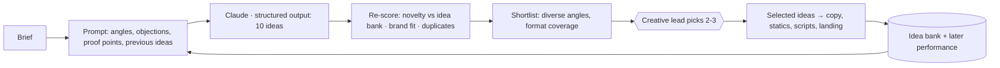

# 01 · AI Idea Generator

**Brief question:** Can AI consistently generate genuinely interesting campaign and creative ideas that feed copywriting, statics, scripts and video? ("One of the most important and difficult areas.")

## Why generic ideas happen, and the fix

Asked for "ideas", a model regresses to the mean: ten variations of "help us help them". Three things fix it, and all three are in the prototype:

1. **Force a named angle per idea.** Twelve angles (contrast, stat-led, testimonial, myth-bust, behind-the-scenes, urgency-match, founder-direct, how-it-works, local-pride, unexpected-comparison, letter, question). No two ideas in a batch share one.
2. **Ground in the brief's friction, not its mission.** The prompt hands the model the audience's *objections* and the client's *proof points*, and demands each idea name which one it uses.
3. **Score in code, not by vibes.** The model self-scores, but we recompute novelty against every idea in the client's history (Jaccard similarity), penalise brand fit for banned words or guardrail hits, demote in-batch duplicates, and rank by a weighted total.

## Workflow

| Step | Who/what | Notes |
|---|---|---|
| Generate | Claude (effort high) | 10 ideas, each with hook, concept, why it works, audience insight, formats, visual direction, risk flags, self-scores |
| Re-score | Code | `rankIdeas()` in `src/areas/ideas/scoring.ts` |
| Shortlist | Code | `selectIdeas()` guarantees angle diversity and that static, video, UGC and landing each have a candidate |
| Select | Human | Gate `ideas.select`, always human |
| Learn | Code + cron | `idea_bank` table stores every idea; a weekly job attaches ROAS of ads built from it |

## Tools and why

- **Claude Opus 5.5 with structured outputs** for generation: idea quality is where model quality shows most, so this is the one place I would not route to a cheaper model.
- **Zod + code scoring** rather than an LLM judge for ranking: deterministic, explainable to a creative director, testable.
- **Postgres idea bank** (Supabase) so novelty has memory across campaigns and clients, and performance can be joined back from True ROAS.

## Quality controls

- Unique angle per batch; excluded angles (already tested this quarter) passed in.
- Novelty penalty from text similarity with previous ideas; duplicates flagged with `duplicateOf` and halved.
- Guardrails on title + hook + concept (banned words, unverified statistics).
- Risk flags surfaced (consent needed, match funding must be confirmed, region split required).

## In the prototype

- `src/areas/ideas/` · tests in `tests/areas/ideas.test.ts`
- `npm run demo` → `out/<brief>/01-ideas.md` (ranked table + the shortlist in full)
- Mock generator writes one template per angle from the brief; with `LLM_PROVIDER=anthropic` the model writes them.

## Improvements next

- LLM-as-judge rubric (clarity, specificity, surprise) sampled nightly with human calibration.
- "Idea lineage" view in True ROAS: which angles win for which cause, by season.
- Pull in competitor/sector creative (Meta Ad Library) as a negative set for novelty.
