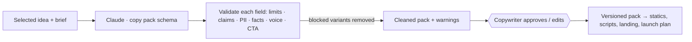

# 02 · AI Copywriting

**Brief question:** Can AI generate high-quality advertising copy consistently: hooks, headlines, primary text, variations and campaign-ready messaging?

## Short answer

Consistently, yes, when three things are true: the model gets a specific idea rather than a blank brief, the output is a typed pack rather than free text, and every field is checked by code before a human reads it. The prototype does all three.

## Workflow

**Copy pack** (`src/areas/copy/types.ts`): 5 hooks, 5 headlines, primary text in short/medium/long, 3 descriptions, 3 Story/Reels overlays, CTA button, 3 messaging pillars.

**Limits** (`src/areas/copy/limits.ts`): primary text 125 recommended / 2200 max, headline 40 / 255, description 30 / 255, overlay 60 / 120. Over recommended = warning (truncation risk); over max = block.

## AI vs human

| AI | Code | Human |
|---|---|---|
| Writes all variants in brand voice at reading age 11-13 | Removes blocked variants, highlights warnings with excerpts, checks a CTA and an impact line exist in every primary text, confirms every number is in the brief | Approves the pack, edits tone, decides which variants launch |

## Quality controls

Shared guardrails (`src/core/guardrails.ts`): guarantees, cure claims, "100% of your donation", "every penny", "tax deductible" (US framing; UK uses Gift Aid), obligation and guilt pressure (Fundraising Regulator code), superlatives, placeholders, email/phone, banned brand words, limits, CTA, reading grade, unverified statistics. The red-team suite in `npm run eval` proves each rule fires.

## Tools and why

- Claude Opus 5.5, effort medium: copy is high-volume, so this is the first task I would A/B against Sonnet 5.5 on the eval set.
- Prompt caching on the system prompt; the brief changes per call, the rules do not.
- Pack stored as an `artefacts` row with `guardrail_score` so quality trends are queryable.

## In the prototype

- `src/areas/copy/` · tests `tests/areas/copy.test.ts`
- `npm run demo` → `out/<brief>/02-copy.md` (pack with character counts and guardrail notes)

## Improvements next

- Learn from winners: feed the top-performing primary texts per client back as few-shot examples.
- Per-placement previews (feed, story, reels) in the review screen.
- Translation pass for bilingual charities with the same guardrails.
