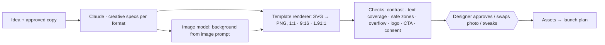

# 03 · AI Static Creative

**Brief question:** Can AI generate strong static ad concepts and finished assets usable for paid advertising, not just generic designs?

## Position

Image models are good at pictures and bad at layouts, type and brand compliance. So I split the job: **the model designs the spec, a template renders it, an image model paints the background.** The spec is data (layout, headline, subline, stat, badge, CTA, image prompt, palette roles), which means brand rules are enforced by construction and QA can run before a designer opens the file.

## Workflow

Layouts: bold-statement, stat-led, split-contrast, quote. The angle picks the layout (stat-led ideas get the stat layout, testimonials get the quote layout).

## AI vs human

| AI | Code | Human |
|---|---|---|
| Writes headline/subline/stat/badge, chooses layout, writes an executable image prompt (subject, light, crop, no faces, no text) | Renders deterministically, checks WCAG contrast (block under 3:1, warn under 4.5:1), text coverage (warn over 35 percent, block over 50), Stories safe zones (top 14 percent, bottom 20), overflow, presence of logo and CTA, consent language in prompts, text guardrails | Approves, chooses or shoots the photo, adjusts crop |

## Tools and why

- **Renderer in code (SVG + resvg)** so output is reproducible and testable; in production the same spec can drive Figma variables, Canva templates or an HTML-to-image service.
- **Image generation** behind the prompt: Ideogram or Imagen for photographic backgrounds, Firefly where licensing matters; always "no text, no faces" so people and type stay under our control. Consent for real service users is a hard rule from the brief.
- **Supabase Storage** for renders; `artefacts` rows for specs and QA scores.

## In the prototype

- `src/areas/static/` · tests `tests/areas/static.test.ts`
- `npm run demo` → `out/<brief>/03-creatives/*.svg|png` and `03-creatives.md`
- Photo areas are placeholders labelled with the image prompt; wiring an image API is a provider adapter.

## Improvements next

- Live image generation with an approval step on the photo before the composite.
- Brand kits per client (fonts, logo files, photo style) stored with the client record.
- Creative fatigue signal from the ads agent triggers a regenerate-from-same-idea job.
