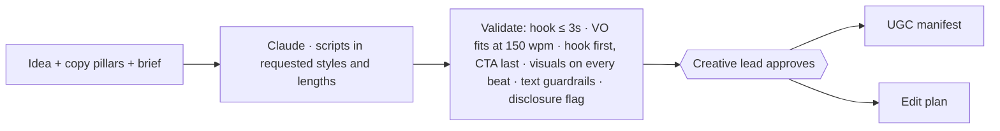

# 04 · AI Script Writing

**Brief question:** Can AI produce strong scripts for ads, UGC-style content and short-form video from a campaign goal, audience and offer?

## Position

Yes, if the script is **structured as beats with timing**, because then it can be checked (does the hook land in 3 seconds? does the voiceover fit 30 seconds?) and handed straight to UGC production and editing without reformatting.

## Workflow

**Script** (`src/areas/scripts/types.ts`): beats hook → problem → turn → proof → offer → cta; each with voiceover, on-screen text (≤ 80 chars), visual, b-roll keywords, seconds. Styles: ugc-testimonial, founder-direct, problem-solution, explainer, story. Lengths: 15 / 30 / 60 seconds with beat-share tables per length.

## AI vs human

| AI | Code | Human |
|---|---|---|
| Writes natural speech in the right voice (first person for UGC and founder, conversational imperfections for UGC) | Pacing and duration maths, structure, text guardrails, synthetic-disclosure flag for testimonial scripts | Approves, picks style mix, decides who presents |

## Tools and why

- Claude Opus 5.5 effort medium; prompt includes the approved messaging pillars so scripts and copy say the same thing.
- Validation is pure code so a producer can trust "15s" means 15s.

## In the prototype

- `src/areas/scripts/` · tests `tests/areas/scripts.test.ts` (every style at every length passes with no warnings)
- `npm run demo` → `out/<brief>/04-scripts.md` (beat tables with timings and QA)

## Improvements next

- Hook variants: generate five hooks per script and test them as the first 3 seconds only.
- Pull proven hook structures from the ads agent's winners back into the prompt.
- Auto-generate the shot list and props list for real creators from the beats.
