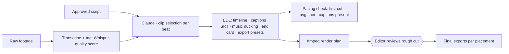

# 06 · AI Video Editing

**Brief question:** Can AI edit videos end to end at a high standard: pacing, cuts, captions, B-roll, audio, branding, export?

## Position

For short-form performance video, **assembly, captions, pacing and exports can be automated to a reviewable rough cut**; the final 10 percent (colour, music taste, a cut that "feels right") stays with an editor, but starting from a structured rough cut cuts the time dramatically. The design here is the same as everywhere else: the model makes the creative selection, code builds the deterministic artefacts, a human reviews.

## Workflow

**EDL** (`src/areas/video/types.ts`): timeline items (video, b-roll, text, logo) with source in/out points, caption cues (≤ 2 lines, ≤ 42 chars, 1-6 s), music bed with -12 dB ducking and fade, brand end card (no logo up front: it kills retention), per-aspect export presets.

## AI vs human

| AI | Code | Human |
|---|---|---|
| Matches beats to clip segments using transcripts and tags, prefers talking-head for spoken beats and b-roll for visual beats, lists unmatched beats | Builds the EDL, never reads past clip bounds, fills gaps with branded text cards, generates SRT, checks pacing, emits the ffmpeg plan | Reviews rough cut, fixes taste, approves export |

## Tools and why

- **Whisper** (or AssemblyAI) for transcription with word timings.
- **ffmpeg** for assembly because it is free, scriptable and runs anywhere; the plan is a list of reviewable commands, not a black box. For premium finishing the same EDL exports to Premiere/Resolve.
- **Claude** for selection only; everything with numbers is deterministic.

## In the prototype

- `src/areas/video/` · tests `tests/areas/video.test.ts`
- `npm run demo` → `out/<brief>/06-video/edl.json`, `captions.srt`, `render-plan.sh`, `pacing.json`
- Sample footage metadata in `samples/raw-clips.json`; the render plan is generated and verified but not executed (no footage files in the repo).

## Improvements next

- Run the plan on real footage in a worker (Supabase Edge Function + Fly/Modal GPU box for speed).
- Scene detection and silence trimming before selection.
- Auto-reframe 16:9 to 9:16 with subject tracking.
