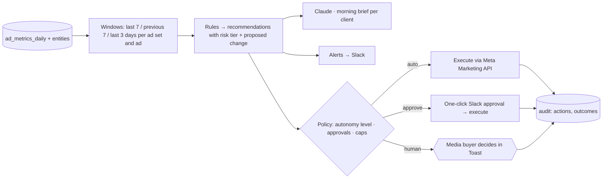

# 07 · AI Media Buyer / Ads Agent

**Brief question:** Can an AI agent support or eventually manage advertising workflows: monitoring, issues, recommendations, alerts, reporting, approved actions?

## Position

Support now, manage later, **never decide with money using a language model.** Decisions that move budget come from deterministic rules a media buyer can read and tune; the model's job is to explain, prioritise and write the morning brief. Autonomy is earned per client through a ladder, with hard caps at every level.

## Workflow

### The seven rules (`src/areas/media-buyer/rules.ts`)

| Rule | Signal | Proposal | Risk |
|---|---|---|---|
| tracking-break | Spend and clicks but zero donations for 3 days after a converting week | Investigate pixel/CAPI/webhook before touching budgets; suppresses all other rules on that ad set | human |
| cpa-spike | 7-day CPA > 1.5x previous and above target | -20 percent budget | approve |
| roas-floor | 7-day ROAS below 0.7x target | -20 percent budget; below 0.35x proposes pause | approve / human |
| scale-winner | ROAS ≥ 1.3x target, CPA on target, learning complete | +20 percent budget inside caps | approve |
| creative-fatigue | Frequency ≥ 3.5 and CTR down ≥ 30 percent | Refresh creative; pause once replacement is live | approve |
| zero-conversion-ad | Ad spent 3x target CPA with no donations while siblings convert | Pause ad | approve |
| learning-limited | Meta status learning-limited (or still learning with < 50 weekly conversions) | Consolidate / broaden / optimise event | human |

Two findings proposing the same change on one entity collapse into the more confident one.

### Autonomy ladder (`decideExecution`)

- **assist**: everything is a recommendation; nothing executes without an explicit approval id.
- **copilot**: auto-tier items (notifications) run; approve-tier get a one-click Slack button (n8n flow `automations/n8n/ads-agent-approval.json`).
- **autopilot**: approve-tier budget moves ≤ 20 percent and under the daily cap execute automatically; single-ad pauses execute; ad-set pauses and anything human-tier still wait. Creative-fatigue pauses never auto-execute, because the replacement must be live first.

Every execution is idempotent (same change twice is a no-op), dry-run by default, and written to `agent_actions` with the request and response.

## AI vs human

| AI | Code | Human |
|---|---|---|
| Writes the brief: what needs a decision today, quick wins, watchlist; explains findings in plain English | Windows, rules, dedupe, risk tiers, caps, idempotent execution, alerts, audit | Approves budget moves, decides pauses and tracking fixes, tunes thresholds per client |

## Tools and why

- **Meta Marketing API** through a thin `MetaAdsClient` interface (mock here; the real client lives in a Supabase Edge Function with the access token, never in n8n or the browser).
- **pg_cron** triggers the daily run; **n8n** handles Slack approvals because that is a human workflow, not a data pipeline.
- **Claude Haiku 5.5** is enough for the brief; the findings carry the numbers.

## In the prototype

- `src/areas/media-buyer/` · tests `tests/areas/media-buyer.test.ts` (each rule, suppression, dedupe, policy matrix, live/dry runs, failures, idempotency)
- `npm run agent -- --autonomy autopilot --live` runs against the mock ads client; `npm run eval` proves 100 percent recall of the injected scenarios with zero extra findings.
- Output: `out/agent/recommendations.md`, `alerts.md`, `briefs.md`.

## Improvements next

- Learn thresholds per client from historical outcomes of accepted vs rejected recommendations.
- Creative-level attribution from True ROAS so "refresh creative" can say which angle to refresh with.
- Launch assistant: build campaigns from the launch plan via the API with a diff preview.
