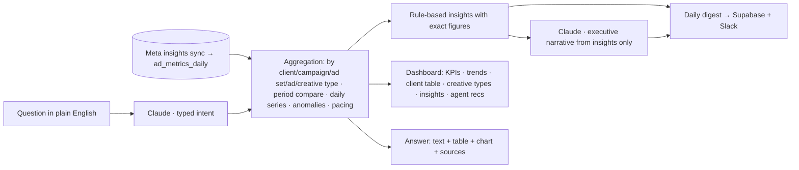

# 09 · Toast / Meta Ads Analysis

**Brief question:** How could AI and automation support collecting and consolidating ad data across client accounts, surfacing key metrics, identifying trends or issues, and presenting insights in a dashboard or reporting flow?

## Position

True ROAS already collects and joins Meta data with donation revenue; Toast is the analysis layer on top. The design rule that makes it trustworthy: **all numbers come from a deterministic aggregation layer; the model only narrates and translates questions.** That is why the dashboard, the digest and "Ask Toast" can never show a figure that is not in the data.

## Workflow

### Insights (`src/areas/toast/insights.ts`)
Portfolio summary; client below ROAS target; client beating target (scale headroom); revenue swings over 25 percent; spend pacing outside 80-110 percent; tracking break (zero donations, clicks continue); creative-type comparison; CPA movers; daily revenue anomalies (rolling z-score). Sorted critical → warning → positive → info.

### Ask Toast (`src/areas/toast/ask.ts`)
Intents: rank clients by a metric, biggest change, client summary, creative-type comparison, anomalies, portfolio total. The model fills a typed intent (metric, client, direction, days, limit); code answers from `aggregate`, `comparePeriods`, `dailySeries`, `detectAnomalies`. Every answer lists its sources. Thumbs up/down on answers feeds the intent-parser eval set.

## AI vs human

| AI | Code | Human |
|---|---|---|
| Writes the weekly narrative from the insight list; turns a question into a typed query | Every metric, comparison, anomaly, pacing calculation; the dashboard | Reads, decides, asks the next question |

## Tools and why

- **Supabase/Postgres** holds the fact table True ROAS already syncs; the aggregation functions become SQL views or an Edge Function.
- **React + TanStack Query** for the dashboard inside True ROAS; the prototype's single-file HTML (Chart.js) shows the same panels with no setup.
- **n8n digest flow** (`automations/n8n/toast-daily-digest.json`): compute → narrate → store → Slack, with a critical-insight page.
- **Claude Haiku 5.5** for intent parsing and narrative: cheap, fast, and the hard maths is not its job.

## In the prototype

- `src/areas/toast/` · tests `tests/areas/toast.test.ts`
- `npm run toast` builds `out/toast/dashboard.html`; `npm run toast:ask -- "Which client had the biggest ROAS drop last week?"`; `npm run web` opens the React Toast view with the same metrics functions running in the browser and a live Ask Toast box.
- Mock dataset: 6 charity clients, 56 days, with injected scenarios so the insights and the agent have something real to find (`src/areas/toast/mock-data.ts`).

## Improvements next

- Wire to the live `ad_metrics_daily` table and the donation join; add client-level targets to the client record.
- Tool-use version of Ask Toast where Claude can chain two queries ("…and how does that compare to last month?").
- Scheduled client-facing PDF/email reports from the same insight list with client-safe language.
